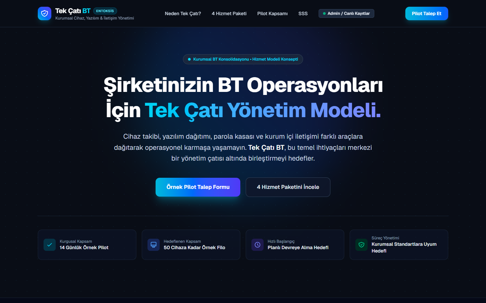
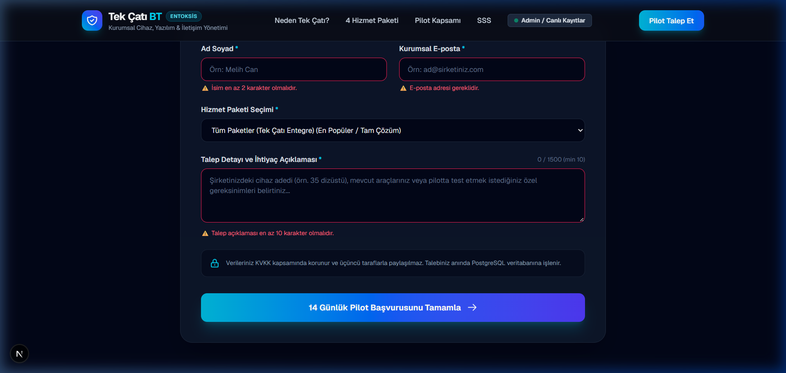
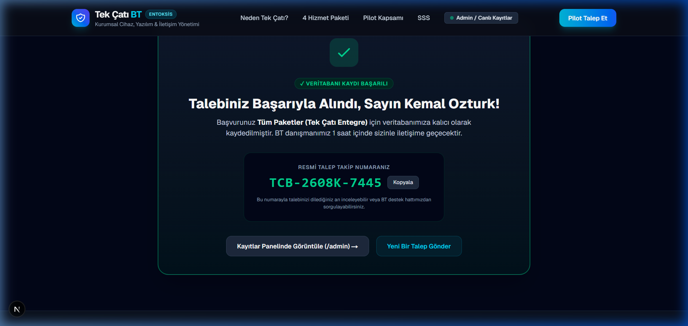
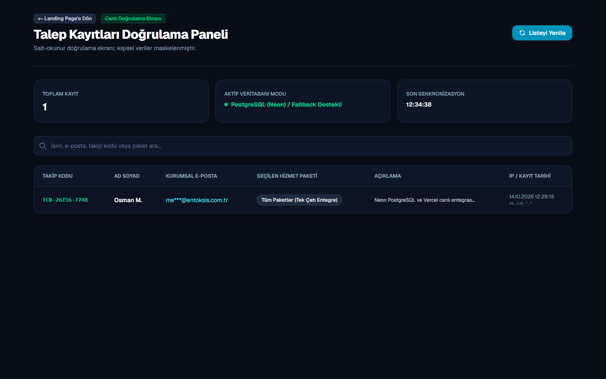
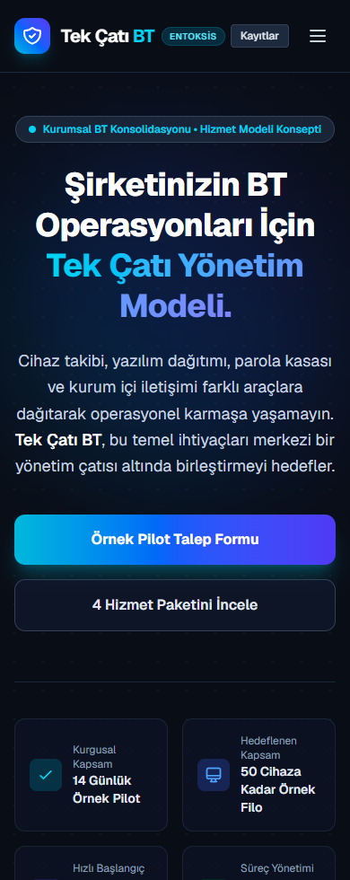
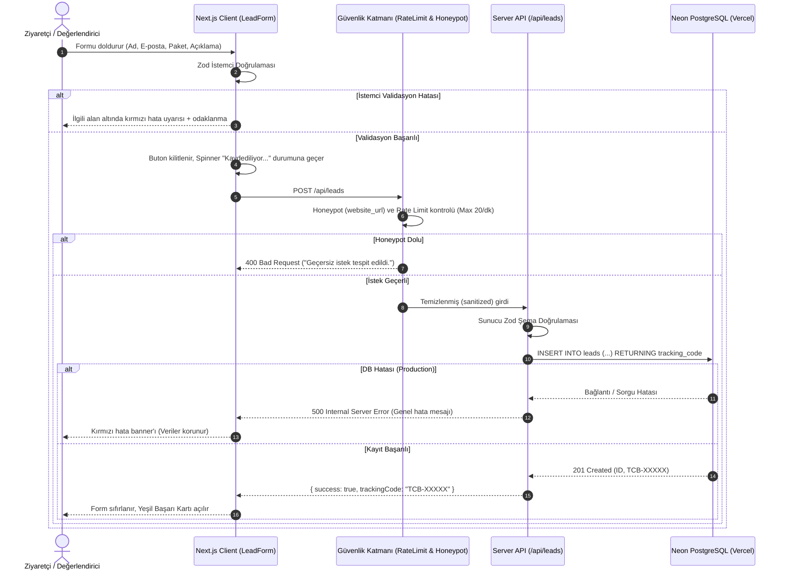

# Tek Çatı BT – Kurumsal Cihaz, Yazılım ve İletişim Yönetimi Hizmeti

**Canlı Demo:** [https://entoksis.vercel.app](https://entoksis.vercel.app)  
**Canlı Kayıt Doğrulama Paneli (Salt-okunur / PII Maskeli):** [https://entoksis.vercel.app/admin](https://entoksis.vercel.app/admin)

[](https://github.com/osmnmlh/entoksis-tek-cati-bt/actions)
[](https://nextjs.org/)
[](https://www.typescriptlang.org/)
[](https://neon.tech/)
[](https://zod.dev/)
[](https://vitest.dev/)
[](./LICENSE)

> **Önemli Not:** Bu bir değerlendirme projesi için kurgulanmış hizmettir. Hizmet paketleri konsepttir; bu repoda yalnızca talep toplama ve veri kalıcılığı sistemi uygulanmıştır.

---

## 📸 Görsel Önizleme & UI Akışı

### 1. Masaüstü Landing Page & 4 Hizmet Paketi
Ziyaretçiyi karşılayan değer önerisi ve modüler 4 hizmet paketi konsepti:


---

### 2. Güvenilir Form & İstemci Tarafı Doğrulama (Client-side Validation)
Eksik veya geçersiz alanlar doldurulmadan form gönderilmek istendiğinde devreye giren anlık hata bildirimleri:


---

### 3. Kalıcı Veritabanı Kaydı ve Gerçek Takip Numaralı Başarı Kartı
Başarı mesajı **yalnızca** sunucuda ve veritabanında fiziksel `INSERT` işlemi başarıyla tamamlandığında gerçek takip koduyla açılır:


---

### 4. Doğrulama / Admin Canlı Denetim Ekranı (`/admin`)
Değerlendiricinin formdan girdiği test kaydını veritabanında anlık olarak doğrulaması için geliştirilen salt-okunur ve PII maskeli denetim paneli:


---

### 5. Mobil Uyumluluk (390px Görünümü)
Tüm butonlar, kartlar, navigasyon ve formlar mobilde rahat bir kullanım sunar:
<p align="center">
  
</p>

---

## 📌 1. Proje Özeti: Kime Yardımcı Oluyor, Hangi Sorunu Çözüyor?

### Problem (Sorun):
Büyüyen şirketlerde her departman farklı ihtiyaçlar için ayrı bir yazılım seçer:
- Cihaz ve donanım takibi için dağınık Excel tabloları,
- Uzaktan yazılım/yama yüklemek için üçüncü taraf programlar,
- Kurumsal şifreler için kontrolsüz parola kasaları,
- Şirket içi yazışma ve dosya paylaşımı için tüketici mesajlaşma uygulamaları.

Bu durum **araç enflasyonuna**, artan lisans maliyetlerine, işten ayrılan personelin erişimlerinin kontrolsüz kalabilmesine ve operasyonel karmaşaya yol açar.

### Çözüm (Değer Önerisi):
**Tek Çatı BT**, bu 4 temel operasyonu tek bir çatı altında birleştirmeyi hedefleyen kurumsal bir hizmet modelidir. Şirketlerin donanımlarını merkezi olarak izlemesini, yazılım dağıtımı yapmasını, kurumsal şifreleri tek merkezden yönetmesini ve güvenli kurum içi iletişim kurmasını amaçlar.

---

## 📦 2. Dört Hizmet Paketi ve Örnek Pilot Kapsamı

### 4 Temel Hizmet Paketi:
1. **Cihaz Envanteri ve İzleme:** Şirket bilgisayarları ve kurumsal cihazların donanım/yazılım sağlık takibi, sistem raporları ve durum kontrolü (pilotta değerlendirilir).
2. **Yazılım Dağıtımı ve Sürüm Takibi:** Hedeflenen cihazlara uzaktan paket kurulumu, güvenlik yamaları, lisans optimizasyonu ve yetkisiz yazılım tespiti.
3. **Parola ve Sır Kasası:** Merkezi yönetilen kurumsal kimlik bilgileri, API anahtarları, rol tabanlı erişim kontrolü ve denetim logları.
4. **Şirket İçi İletişim ve Güvenli Dosya Paylaşımı:** Kurum sınırları içinde kalan kontrollü mesajlaşma, süreli ve kısıtlı dosya paylaşımı.
5. *(Entegre Model)* **Tüm Paketler (Tek Çatı Entegre):** 4 hizmetin tamamının tek bir çatı altında birleştirilmesini hedefleyen kurumsal paket konsepti.

### Örnek Pilot Kapsamı (Kurgusal):
- **14 Günlük Örnek Pilot Süreci:** Bağlayıcı taahhüt içermeyen kurgusal deneme süreci.
- **Hedeflenen 50 Cihaz Kapsamı:** Test amaçlı hedeflenen cihaz filosu.
- **Planlı Devreye Alma Süreci:** İş kesintisini en aza indirmeyi hedefleyen geçiş modeli.
- **Teknik Danışmanlık Desteği:** Pilot sürecinde ihtiyaçların analiz edilmesi.

---

## 🧠 3. Yazılı Problem Çözme ve Mimari Kararlar

### Problem Analizi ve Çözüm Yaklaşımı
Case study'nin ana odağı, şirketlerin dağınık araçlarla yönettiği BT operasyonlarını tek bir merkezde toplayan bir değer önerisi sunmak ve ziyaretçinin bu hizmete yönelik talebini sunucuda kalıcı bir kayda dönüştürmektir. Kullanıcı güvenini tesis etmek adına form doğrulamasının iki katmanda (istemci ve sunucu) yapılması ve başarı geri bildiriminin yalnızca veritabanına fiziksel yazım gerçekleştiğinde verilmesi kararlaştırılmıştır.

### Neden Next.js (App Router) + Neon PostgreSQL?
- **Tek Yığın (Unified Stack):** Frontend (React 19) ile Backend API rotalarının (`/api/leads`) aynı çatı altında tip güvenliğiyle (TypeScript + Zod) yönetilmesi sağlandı.
- **Vercel Serverless & Kalıcılık:** Vercel sunucusuz mimarisi her istekte geçici (ephemeral) container'lar çalıştırır. Dosya tabanlı veritabanları (SQLite gibi) sunucusuz ortamlarda kalıcı olamaz; container kapandığında dosya silinir. Bu nedenle doğrudan Vercel ortamıyla tam uyumlu çalışan, bağlantı havuzlama (connection pooling) destekli **Neon Serverless PostgreSQL** tercih edildi.

### Bilerek Yapılmayanlar (Kapsam Sınırları ve Sadeliğin Korunması):
Overengineering'den kaçınmak ve teslim gereksinimlerine odaklanmak amacıyla şu bileşenler bilinçli olarak eklenmemiştir:
- **Kullanıcı Girişi / Auth (JWT/NextAuth):** Case study bir landing page ve talep toplama sürecidir; son kullanıcı veya aday için şifreli üyelik bariyeri eklenmemiştir.
- **SMTP E-posta Gönderimi:** Üçüncü taraf harici API bağımlılıkları (SendGrid/Resend) değerlendiricinin yerel çalıştırmasını zorlaştıracağı için e-posta gönderimi yerine gerçek zamanlı takip kodu üretimi tercih edilmiştir.
- **Ağır UI / Animasyon Kütüphaneleri:** Framer Motion gibi 100KB+ runtime maliyeti olan kütüphaneler yerine saf Tailwind CSS geçişleri ve native SVG spinner kullanılmıştır.
- **Çoklu Veritabanı Tabloları:** Bu aşamada ilişkisel karmaşa yaratmamak için tek ve optimize edilmiş `leads` tablosu yeterli görülmüştür.

### Fallback Kararı ve Production'da Kapatılma Gerekçesi
- Yerel geliştirme ortamında ve otomatik testlerde (`process.env.NODE_ENV !== 'production'`), değerlendiricinin harici bir PostgreSQL URL'i girmesine gerek kalmadan tek komutla test yapabilmesi için in-memory fallback mekanizması sağlanmıştır.
- Ancak **production (`NODE_ENV === 'production'`) ortamında fallback kesin olarak kapatılmıştır**. Canlı ortamda `DATABASE_URL` eksikse veya veritabanı sorgusu başarısız olursa sistem asla sessizce belleğe yazıp kullanıcıya sahte başarı dönmez; doğrudan 500 fırlatarak veri kalıcılığı ilkesini garanti altına alır.

---

## 🏗️ 4. Veri Akışı Şeması



---

## ⚙️ 5. Kurulum ve Çalıştırma Adımları

### Gereksinimler:
- Node.js (v18.18+ veya v20/v22)
- npm veya pnpm / yarn

### 1. Depoyu Klonlayın:
```bash
git clone https://github.com/osmnmlh/entoksis-tek-cati-bt.git
cd entoksis-tek-cati-bt
```

### 2. Bağımlılıkları Yükleyin:
```bash
npm install
```

### 3. Ortam Değişkenleri (İsteğe Bağlı):
Proje kök dizinindeki `.env.example` dosyasını `.env.local` olarak kopyalayabilirsiniz:
```bash
cp .env.example .env.local
```
> **Çalışma Notu:** `NODE_ENV !== 'production'` (dev ve test) iken `DATABASE_URL` tanımlanmadığında testlerin aksamaması için yerel bellek adaptörü devreye girer. `DATABASE_URL` tanımlandığında ise otomatik olarak bulut PostgreSQL veritabanına bağlanır ve tabloları otomatik oluşturur.

### 4. Geliştirme Sunucusunu Başlatın:
```bash
npm run dev
```
- **Ana Sayfa:** `http://localhost:3000`  
- **Admin / Canlı Doğrulama Paneli:** `http://localhost:3000/admin`

### 5. Üretim Derlemesi (Production Build):
```bash
npm run build
npm run start
```

---

## 🧪 6. Otomatik Testleri Çalıştırma

Tüm birim ve entegrasyon testleri Vitest ile yazılmıştır:
```bash
npm test
```
**Test Kapsamı (31 Test, 100% Başarılı):**
- `src/tests/mask.test.ts` (13 test):
  - E-posta maskeleme (`ke***@domain.com.tr`)
  - IPv4 son iki oktet ve IPv6 ilk bölüm dışı maskeleme
  - İsim formatı maskeleme (`Kemal Ö.`)
  - Açıklama 40 karakter + `…` sınırlama testi
  - Tam `LeadRecord` nesnesi maskeleme testi
- `src/tests/api.test.ts` (4 test):
  - Honeypot (`website_url`) dolu geldiğinde 400 Bad Request dönmesi ve DB'ye yazılmaması
  - Production modunda (`NODE_ENV=production`) DATABASE_URL yokken veya geçersizken 500 dönmesi, asla 201 ve takip kodu dönmemesi
  - `GET /api/leads` endpoint'inin dönen verilerde sunucu tarafında maskeleme uygulaması
- `src/tests/db.test.ts` (5 test):
  - `TCB-` formatlı takip kodu üretimi
  - Kayıt ekleme ve okuma döngüsü
  - Production ortamında DATABASE_URL yoksa `insertLead` fonksiyonunun hata fırlatması
  - XSS girdi temizleme (sanitization)
  - Rate limiter sınır kontrolü
- `src/tests/validation.test.ts` (9 test):
  - Zod şema kuralları (kısa isim, geçersiz karakter, geçersiz e-posta, tanımsız paket, kısa açıklama reddi)

---

## 🛡️ 7. Temel Güvenlik ve Gizlilik Önlemleri

1. **Çift Taraflı Doğrulama:** İstemcide anlık kullanıcı geri bildirimi için Zod; sunucuda manipülasyonu engellemek için bağımsız Zod parse kontrolü.
2. **Kalıcı Kayıt Güvencesi:** Başarı ekranı ve takip numarası **yalnızca** veritabanı kaydı onaylandığında gösterilir; sunucu hatasında formdaki girdiler korunur, kullanıcıya hata sebebi bildirilir.
3. **Sunucu Taraflı PII Maskeleme:** `/admin` ekranı ve `GET /api/leads` yanıtında ad, e-posta, IP ve açıklama alanları sunucu tarafında maskelenir; tarayıcıya ham kişisel veri iletilmez.
4. **Honeypot Koruması:** Kullanıcıya görünmeyen sahte `website_url` alanı doldurulduğunda istek 400 Bad Request ile anında reddedilir.
5. **IP Rate Limiting:** Aynı IP adresinden dakikada 20'den fazla istek geldiğinde `429 Too Many Requests` döndürülür.
6. **Arama Motoru İndeks Engeli:** `/admin` rotası için `robots: { index: false, follow: false }` metadata'sı tanımlanmıştır.
7. **SQL Injection Koruması:** Neon şablon literalleri ile parametrik sorgulama (`$1, $2, ...`) kullanılır.

---

## 👤 8. Geçmiş Projeler ve Kişisel Katkı

Geliştirici portföyü ve teknik geçmişe dair somut referans projeler:

- **Smart Campus Adaptive Lighting System:** ESP32 mikrodenetleyicileri, LDR/PIR sensörleri ve merkezi sunucu iletişimiyle enerji verimliliği sağlayan IoT ve donanım staj projesi. ([github.com/osmnmlh/smart-campus-adaptive-lighting](https://github.com/osmnmlh/smart-campus-adaptive-lighting))
- **aitrouble:** Go dili ile geliştirilmiş; açık kaynak yapay zeka API entegrasyonlarındaki bağlantı, kota ve yapılandırma hatalarını terminalden otomatik analiz eden CLI teşhis aracı. ([github.com/osmnmlh/aitrouble](https://github.com/osmnmlh/aitrouble))
- **Room Rent v3.0:** JavaScript ve PostgreSQL tabanlı; kiralama süreçlerini ve rezervasyon takvimini uçtan uca yöneten tam yığın (full-stack) web uygulaması.

**Kişisel Katkı:** Bu projede konsept tanımı, sistem mimarisi, güvenlik ve veri kalıcılığı gereksinimlerinin belirlenmesi, kod incelemeleri (code review) ve doğrulama süreçleri şahsıma aittir. Kod üretiminde AI ajanı eş-programcı olarak kullanılmış olup kararlar ve müdahaleler [AI_LOG.md](./AI_LOG.md) dosyasında belgelenmiştir.

---

## ⚠️ 9. Bilinen Eksikler ve Kısıtlar

- **Rate Limiter Bellek Kapsamı:** Mevcut IP rate limiter tek instance'ın bellek haritasında tutulmaktadır. Vercel üzerinde çoklu sunucusuz instance'lar arasında tam senkronizasyon için Upstash Redis gibi harici bir anahtar-değer deposu gereklidir.
- **Salt-Okunur Admin:** `/admin` paneli bir oturum yönetim sistemi (login) içermez; değerlendiricinin test kaydını kolayca doğrulaması için tasarlanmış açık, salt-okunur ve kişisel verileri maskeli bir denetim ekranıdır.
- **E-posta Gönderimi:** Form gönderildiğinde müşteriye gerçek SMTP/API üzerinden onay e-postası iletimi bu aşamada kapsam dışı bırakılmıştır.

---

## 🏷️ Teslim Bilgisi
- **Teslim Commit Kimliği:** Teslim commit kimliği teslim formunda ve teslim git etiketindedir.
- **Repo:** [github.com/osmnmlh/entoksis-tek-cati-bt](https://github.com/osmnmlh/entoksis-tek-cati-bt)
- **Lisans:** [MIT](./LICENSE)
- **Tarih:** Ekim 2026
- **Geliştirici:** Osman Melih Gümüş
